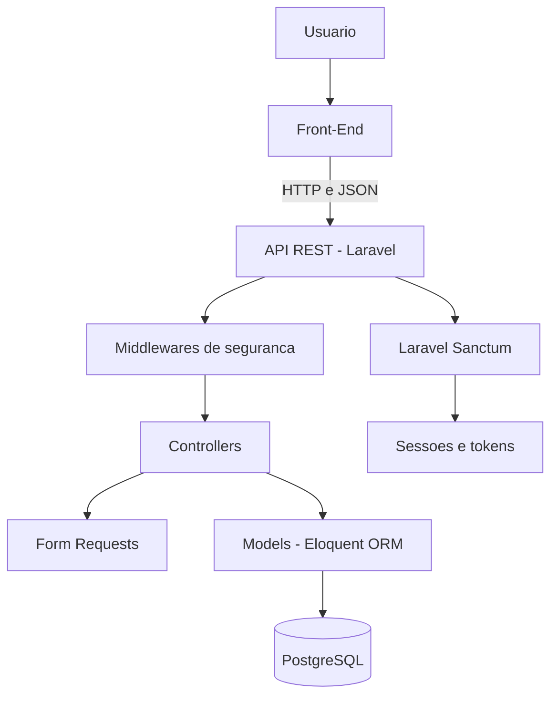
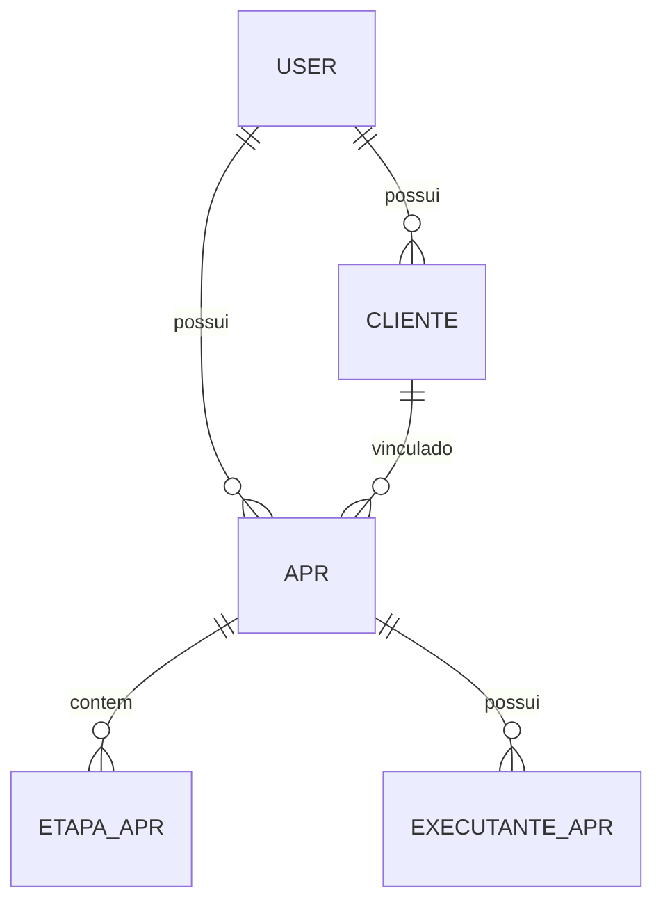
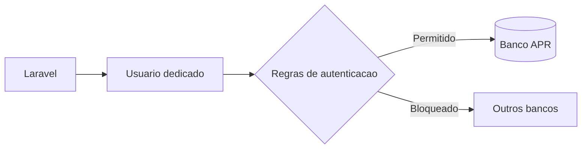

<div align="center">

# 🛡️ Sistema APR

### Sistema de Gestão e Emissão de Análise Preliminar de Risco

**SENAI Americana — Desenvolvimento de Sistemas**


</div>

---

## 📖 Sobre o projeto

O Sistema APR é uma aplicação web desenvolvida com o objetivo de digitalizar, organizar e automatizar o processo de elaboração de Análises Preliminares de Risco no ambiente educacional do SENAI.

A plataforma permite que usuários autenticados cadastrem clientes, consultem um catálogo de riscos previamente registrado, organizem etapas de atividades e emitam documentos para impressão ou exportação em PDF.

O projeto busca reduzir o preenchimento repetitivo de informações, melhorar a organização dos documentos e garantir maior controle sobre os registros cadastrados.

Seu desenvolvimento prioriza segurança, organização arquitetural, manutenção, integridade dos dados e experiência do usuário.

> O sistema é um projeto educacional. As informações técnicas do catálogo e os documentos emitidos devem ser revisados por profissionais qualificados antes de qualquer utilização em atividades reais.

---

## 🎯 Objetivos

- Digitalizar o processo de elaboração de APRs.
- Centralizar informações em uma aplicação web.
- Automatizar o preenchimento de informações recorrentes.
- Organizar o histórico de documentos.
- Proteger os dados dos usuários.
- Implementar controle de acesso baseado em permissões.
- Aplicar boas práticas de desenvolvimento Back-End.
- Garantir a manutenção e a evolução do sistema.
- Desenvolver uma aplicação com testes automatizados.
- Preparar o projeto para uma futura implantação.

---

## 🚀 Funcionalidades

### Autenticação

- Cadastro de usuários.
- Login e logout.
- Autenticação por sessões.
- Autenticação por tokens utilizando Laravel Sanctum.
- Controle de expiração de sessões e tokens.
- Proteção contra tentativas excessivas de login.
- Armazenamento seguro de senhas com hash.
- Controle de acesso às rotas protegidas.

### Gerenciamento de APRs

- Criação de novas APRs.
- Consulta de documentos cadastrados.
- Atualização de documentos.
- Exclusão de documentos.
- Reutilização de APRs existentes.
- Cadastro de etapas da atividade.
- Cadastro de executantes.
- Numeração automática das etapas.
- Histórico individualizado por usuário.
- Visualização para impressão e exportação em PDF.

### Gerenciamento de clientes

- Cadastro de clientes.
- Consulta de clientes.
- Atualização de informações.
- Exclusão de clientes sem APRs vinculadas.
- Validação dos dados cadastrados.
- Isolamento dos registros por usuário.

### Catálogo de riscos

- Consulta de riscos previamente cadastrados.
- Organização por categorias.
- Preenchimento automático de informações.
- Gerenciamento administrativo do catálogo.
- Restrição de operações de escrita para administradores.

---

## 🏗️ Arquitetura do sistema

O projeto utiliza uma arquitetura com separação entre Front-End e Back-End, comunicando-se através de uma API REST.



### Back-End

Responsável pelas regras de negócio, autenticação, autorização, validação, processamento das requisições e comunicação com o banco de dados.

### Front-End

Responsável pela interface, interação com o usuário, comunicação com a API, preenchimento dos formulários e visualização dos documentos.

### Banco de dados

Responsável pelo armazenamento persistente das informações, relacionamentos, sessões, tokens e registros do sistema.

---

## 💻 Tecnologias utilizadas

### Back-End

| Tecnologia | Finalidade |
|---|---|
| PHP | Linguagem principal |
| Laravel 13 | Framework Back-End |
| Laravel Sanctum | Autenticação |
| Eloquent ORM | Persistência e consultas |
| Composer | Gerenciamento de dependências |
| PHPUnit | Testes automatizados |

### Front-End

| Tecnologia | Finalidade |
|---|---|
| HTML5 | Estrutura das interfaces |
| CSS3 | Estilização e layout |
| JavaScript | Interatividade e integração com a API |
| Fetch API | Requisições HTTP |

### Banco de dados e infraestrutura

| Tecnologia | Finalidade |
|---|---|
| PostgreSQL | Banco de dados principal |
| SQLite | Banco de dados isolado para testes |
| WSL / Ubuntu | Ambiente de desenvolvimento |
| Git | Controle de versão |
| GitHub | Hospedagem do código-fonte |
| Gitleaks | Auditoria de credenciais |
| Composer Audit | Auditoria de dependências |

---

## 📂 Estrutura do projeto

```text
sistema-apr/
│
├── backend/
│   ├── app/
│   │   ├── Http/
│   │   │   ├── Controllers/
│   │   │   ├── Middleware/
│   │   │   └── Requests/
│   │   ├── Logging/
│   │   ├── Models/
│   │   └── Providers/
│   │
│   ├── bootstrap/
│   ├── config/
│   ├── database/
│   │   ├── factories/
│   │   ├── migrations/
│   │   └── seeders/
│   │
│   ├── public/
│   ├── routes/
│   │   ├── api.php
│   │   └── console.php
│   │
│   ├── storage/
│   ├── tests/
│   │   ├── Feature/
│   │   └── Unit/
│   │
│   ├── .env.example
│   ├── .gitignore
│   ├── artisan
│   ├── composer.json
│   └── phpunit.xml
│
├── frontend/
│   ├── js/
│   │   └── api.js
│   ├── index.html
│   ├── dashboard.html
│   └── imprimir.html
│
├── .gitignore
└── README.md
```

Estrutura resumida dos principais componentes.

---

## 🗄️ Banco de dados

O sistema utiliza PostgreSQL como banco de dados principal.

### Principais entidades

| Entidade | Responsabilidade |
|---|---|
| User | Usuários e autenticação |
| Cliente | Informações dos clientes |
| Apr | Documentos de análise preliminar de risco |
| EtapaApr | Etapas associadas às APRs |
| ExecutanteApr | Executantes vinculados aos documentos |
| CatalogoRisco | Catálogo de riscos e informações associadas |

### Relacionamentos



O catálogo fornece informações reutilizáveis para o preenchimento das etapas. As informações selecionadas são armazenadas no documento correspondente.

### Tabelas auxiliares

O sistema também utiliza tabelas destinadas a:

- Sessões.
- Tokens de acesso.
- Cache.
- Bloqueios de cache.
- Filas de processamento.
- Histórico de migrations.
- Recuperação de senhas.

---

## 🌐 API REST

A comunicação entre Front-End e Back-End utiliza requisições HTTP e respostas JSON.

### Autenticação

| Método | Endpoint | Descrição |
|---|---|---|
| POST | /api/register | Cadastrar usuário |
| POST | /api/login | Autenticar usuário |
| POST | /api/logout | Encerrar autenticação |
| GET | /api/user | Consultar usuário autenticado |
| GET | /sanctum/csrf-cookie | Inicializar proteção CSRF |

### APRs

| Método | Endpoint | Descrição |
|---|---|---|
| GET | /api/aprs | Listar APRs |
| POST | /api/aprs | Criar APR |
| GET | /api/aprs/{id} | Consultar APR |
| PUT/PATCH | /api/aprs/{id} | Atualizar APR |
| DELETE | /api/aprs/{id} | Excluir APR |

### Clientes

| Método | Endpoint | Descrição |
|---|---|---|
| GET | /api/clientes | Listar clientes |
| POST | /api/clientes | Cadastrar cliente |
| GET | /api/clientes/{id} | Consultar cliente |
| PUT/PATCH | /api/clientes/{id} | Atualizar cliente |
| DELETE | /api/clientes/{id} | Excluir cliente |

Os endpoints de gerenciamento exigem autenticação.

Para consultar todas as rotas, incluindo as do catálogo:

```bash
php artisan route:list
```

---

## 🔐 Segurança

A segurança é uma das prioridades do desenvolvimento do Sistema APR.

### Autenticação e autorização

- Laravel Sanctum.
- Autenticação por sessões e tokens.
- Controle de acesso baseado em funções (RBAC).
- Perfis de aluno e administrador.
- Proteção contra acesso a registros de outros usuários.
- Revogação de tokens no logout.
- Regeneração da sessão após autenticação.
- Expiração global dos tokens em 120 minutos.
- Expiração por inatividade das sessões em 120 minutos.

### Segurança de senhas

- Armazenamento utilizando hash bcrypt.
- Política de tamanho mínimo para novas senhas.
- Validação de tamanho máximo.
- Proteção contra entradas inválidas.
- Compatibilidade com usuários cadastrados anteriormente.
- Mensagens genéricas para credenciais incorretas.

### Proteção contra força bruta

- Rate limiting nas rotas de autenticação.
- Limitação de tentativas por endereço IP.
- Limitação de tentativas por e-mail e IP.
- Bloqueio temporário após tentativas excessivas.
- Controle de requisições de cadastro.

### Segurança das requisições

- Validação de dados através de Form Requests.
- Restrição de campos aceitos pela API.
- Proteção contra atribuição indevida de propriedades.
- Verificação de propriedade dos registros.
- Consultas parametrizadas através do ORM.
- Tratamento de identificadores inválidos.
- Limitação do tamanho dos dados recebidos.

### Segurança dos cookies

- Cookies de sessão com HttpOnly.
- Configuração SameSite.
- Proteção CSRF.
- Encerramento de sessões no logout.
- Configuração Secure prevista para implantação HTTPS.

### Segurança do CORS

- Origens autorizadas configuráveis pelo ambiente.
- Métodos HTTP definidos explicitamente.
- Cabeçalhos permitidos definidos explicitamente.
- Ausência de curingas nas origens.
- Suporte à autenticação por cookies.
- Testes automatizados para origens permitidas e não permitidas.

### Tratamento de erros

- Respostas JSON padronizadas.
- Proteção contra exposição de informações internas.
- Tratamento de erros de autenticação e autorização.
- Preservação das mensagens de validação.
- Sanitização de exceções nos canais de log configurados.
- Rotação e retenção dos logs.

### Proteção do repositório

- Arquivos de ambiente ignorados pelo Git.
- Proteção de chaves privadas.
- Proteção de backups e logs.
- Dependências não versionadas.
- Arquivo `.env.example` sem credenciais reais.
- Auditoria do histórico Git utilizando Gitleaks.

---

## 🛡️ Segurança do PostgreSQL

A aplicação utiliza uma conta de banco de dados dedicada, seguindo o princípio do menor privilégio.

### Melhorias implementadas

- Separação entre conta administrativa e conta da aplicação.
- Remoção de privilégios de superusuário da conexão do Laravel.
- Restrição de criação de bancos e usuários.
- Permissões específicas para tabelas e sequências.
- Restrição de alterações estruturais pela conta da aplicação.
- Isolamento de conexões através do `pg_hba.conf`.
- Autenticação SCRAM-SHA-256.
- Backup preventivo antes de alterações administrativas.
- Validação das permissões por consultas e testes de integração.



As permissões de funcionamento da aplicação são separadas das permissões necessárias para migrations e administração do banco.

As configurações administrativas do PostgreSQL são locais e não são armazenadas no repositório.

---

## ⏰ Automação e manutenção

O projeto possui uma rotina agendada para a limpeza de tokens expirados do Laravel Sanctum.

```bash
php artisan sanctum:prune-expired --hours=24
```

### Configuração

- Frequência: diária.
- Horário: 03h.
- Fuso horário: America/Sao_Paulo.
- Retenção adicional após expiração: 24 horas.
- Proteção contra execuções simultâneas.

A rotina foi validada por testes automatizados que verificam a remoção de tokens antigos e a preservação de tokens válidos.

A execução automática depende da ativação do scheduler no ambiente de implantação.

---

## 🧪 Testes automatizados

O projeto utiliza PHPUnit para validar funcionalidades e mecanismos de segurança.

Os testes são executados utilizando SQLite em memória, de forma isolada do PostgreSQL utilizado pela aplicação.

### Últimos resultados confirmados

| Indicador | Resultado |
|---|---|
| Testes executados | 131 |
| Testes aprovados | 131 |
| Asserções aprovadas | 565 |
| Falhas | 0 |
| Tempo de execução | 12,13 segundos |

### Áreas cobertas

- Isolamento do banco de testes.
- Autenticação.
- Autorização.
- Controle de acesso administrativo.
- Segurança dos tokens.
- Expiração das sessões.
- Política de senhas.
- Rate limiting.
- Validação de APRs.
- Validação de clientes.
- Validação do catálogo de riscos.
- Segurança do CORS.
- Tratamento de erros.
- Sanitização de exceções.
- Limpeza de tokens expirados.

### Executar todos os testes

```bash
cd backend
php artisan test
```

### Verificar o isolamento do banco

```bash
php artisan test --filter=DatabaseIsolationTest
```

### Testar o CORS

```bash
php artisan test --filter=CorsSecurityTest
```

### Testar a autenticação

```bash
php artisan test --filter=AuthSecurityTest
```

### Testar a limpeza de tokens

```bash
php artisan test --filter=TokenPruningTest
```

### Evolução dos testes

| Marco do desenvolvimento | Testes | Asserções |
|---|---:|---:|
| Início da auditoria final | 118 | 533 |
| Melhorias do CORS | 126 | 554 |
| Limpeza de tokens expirados | 131 | 565 |

> Os resultados representam as últimas execuções confirmadas e não constituem uma garantia de ausência de vulnerabilidades.

---

## 🔎 Auditorias de segurança

### Dependências

```bash
composer audit
```

Na última auditoria registrada, nenhuma vulnerabilidade conhecida foi reportada pelo Composer após a atualização das dependências afetadas.

### Credenciais

```bash
gitleaks git --redact=100 --no-banner --log-opts="--all" .
```

Na última análise registrada:

- 22 commits analisados.
- Aproximadamente 851,93 KB analisados.
- Nenhum vazamento detectado pelas regras da ferramenta.

Novas auditorias devem ser realizadas periodicamente, especialmente antes da implantação.

---

## ⚙️ Instalação e configuração

### Pré-requisitos

- PHP compatível com a versão do Laravel utilizada.
- Composer.
- PostgreSQL.
- Extensões PHP necessárias.
- PDO PostgreSQL.
- PDO SQLite para os testes.
- Git.
- Navegador atualizado.
- Servidor HTTP local para o Front-End.

### 1. Clonar o repositório

```bash
git clone https://github.com/caiomarcellino11/sistema-apr.git
cd sistema-apr
```

### 2. Instalar as dependências

```bash
cd backend
composer install
```

### 3. Configurar o ambiente

Em uma instalação nova, crie o arquivo `.env` a partir do `.env.example`.

Linux:

```bash
cp .env.example .env
```

Windows PowerShell:

```powershell
Copy-Item .env.example .env
```

Configure as credenciais do seu próprio banco de dados.

```dotenv
DB_CONNECTION=pgsql
DB_HOST=127.0.0.1
DB_PORT=5432
DB_DATABASE=nome_do_banco
DB_USERNAME=usuario_da_aplicacao
DB_PASSWORD=
```

Configure as origens permitidas:

```dotenv
CORS_ALLOWED_ORIGINS=http://127.0.0.1:5500,http://localhost:5500
```

### 4. Gerar a chave da aplicação

Somente para uma instalação nova:

```bash
php artisan key:generate
```

### 5. Preparar o banco de dados

Em um banco novo e devidamente configurado:

```bash
php artisan migrate
```

As migrations devem ser executadas com uma conta que possua as permissões administrativas necessárias.

A conta utilizada pela aplicação em funcionamento deve possuir privilégios limitados.

> Não sobrescreva arquivos `.env` existentes nem regenere a chave de uma instalação em uso sem avaliar as consequências.

> Não utilize comandos de recriação do banco em ambientes que possuam registros importantes.

### 6. Iniciar o Back-End

```bash
php artisan serve --host=127.0.0.1 --port=8000
```

API:

```text
http://127.0.0.1:8000/api
```

### 7. Iniciar o Front-End

Abra a pasta do projeto no Visual Studio Code e utilize o Live Server.

Endereço de desenvolvimento:

```text
http://127.0.0.1:5500/frontend/
```

Utilize o mesmo hostname previsto nas configurações do Sanctum e do CORS.

---

## 📈 Roadmap de desenvolvimento

### Fase 1 — Estrutura inicial

- [x] Estruturação do Back-End.
- [x] Integração com PostgreSQL.
- [x] Desenvolvimento da API REST.
- [x] Desenvolvimento das interfaces.
- [x] Cadastro e gerenciamento de APRs.
- [x] Integração do catálogo.
- [x] Visualização para impressão.

### Fase 2 — Segurança da aplicação

- [x] Autenticação com Laravel Sanctum.
- [x] Controle de acesso RBAC.
- [x] Isolamento de registros por usuário.
- [x] Proteção contra força bruta.
- [x] Política de senhas.
- [x] Validação das requisições.
- [x] Tratamento seguro de erros.
- [x] Sanitização de exceções.
- [x] Proteção de arquivos sensíveis.
- [x] CORS dinâmico.
- [x] Proteção CSRF.
- [x] Expiração e revogação de tokens.
- [x] Agendamento da limpeza de tokens.
- [x] Usuário dedicado no PostgreSQL.
- [x] Isolamento de conexões entre bancos.
- [ ] Finalização da revisão de credenciais.
- [ ] Revisão da criptografia das sessões.
- [ ] Auditoria de integridade do banco.
- [ ] Testes de transações e rollback.
- [ ] Revisão final da segurança.

### Fase 3 — Modernização visual

- [ ] Modernização do dashboard.
- [ ] Melhoria da experiência do usuário.
- [ ] Melhoria da responsividade.
- [ ] Organização das interfaces.
- [ ] Identificação das turmas do SENAI.
- [ ] Melhoria da identificação dos documentos.

### Fase 4 — Expansão do catálogo

- [ ] Levantamento de informações com os instrutores.
- [ ] Expansão das categorias de atividades.
- [ ] Organização dos riscos catalogados.
- [ ] Revisão técnica das informações.
- [ ] Melhorias no preenchimento automático.

### Fase 5 — Evolução funcional

- [ ] Aprimoramento do histórico.
- [ ] Novas automações.
- [ ] Melhorias na gestão de executantes.
- [ ] Aprimoramento da edição de documentos.
- [ ] Melhorias na geração de PDF.
- [ ] Ampliação dos testes automatizados.

### Fase 6 — Implantação

- [ ] Revisão das configurações de produção.
- [ ] Configuração de HTTPS.
- [ ] Configuração do banco de produção.
- [ ] Ativação do scheduler.
- [ ] Hospedagem do Back-End.
- [ ] Hospedagem definitiva do Front-End.
- [ ] Testes em produção.
- [ ] Documentação final.

---

## 📋 Auditoria final de segurança

| Etapa | Status |
|---|---|
| 1. Auditoria das dependências | Concluída |
| 2. Revisão do `.env.example` | Concluída |
| 3. Proteção de arquivos e credenciais | Concluída |
| 4. Cookies, CORS e CSRF | Concluída |
| 5. Tokens, sessões e credenciais | Em andamento |
| 6. Integridade do PostgreSQL | Pendente |
| 7. Transações e rollback | Pendente |
| 8. Revisão final do código | Pendente |
| 9. Documentação de segurança | Pendente |
| 10. Testes finais e commit | Pendente |

**Progresso da auditoria: 40%.**

---

## 📌 Estado atual do desenvolvimento

Última atualização: 28/11/2026.

O Sistema APR encontra-se em desenvolvimento, atualmente na etapa de auditoria final de segurança.

### Último marco concluído

- Criação de uma conta dedicada no PostgreSQL.
- Aplicação do princípio do menor privilégio.
- Configuração do isolamento entre bancos.
- Validação das permissões da aplicação.
- Testes manuais de integração com a nova conta.
- Atualização da credencial da conta da aplicação.
- Confirmação das quantidades de registros existentes.

### Ponto de retomada

Etapa 5.6.4 — Revisão e substituição da credencial
administrativa do PostgreSQL.

As próximas atividades incluem:

- Verificar as dependências da conta administrativa.
- Finalizar a rotação das credenciais.
- Revisar a chave de criptografia da aplicação.
- Avaliar a criptografia das sessões.
- Executar os testes finais da etapa 5.

A implantação permanece planejada para as etapas finais.

---

## 👨‍💻 Desenvolvimento

Projeto desenvolvido no contexto do curso técnico de
Desenvolvimento de Sistemas do SENAI Americana.

### Desenvolvedor

**Caio Martins**

- GitHub: https://github.com/caiomarcellino11

---

<div align="center">

### Sistema APR — Tecnologia, segurança e automação

**Projeto educacional em desenvolvimento.**

</div>